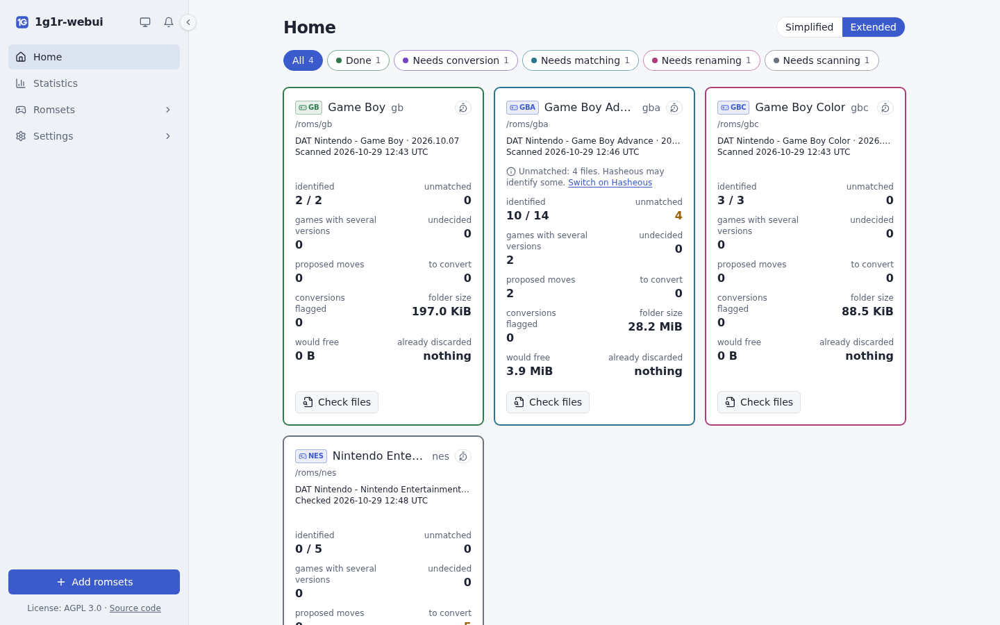
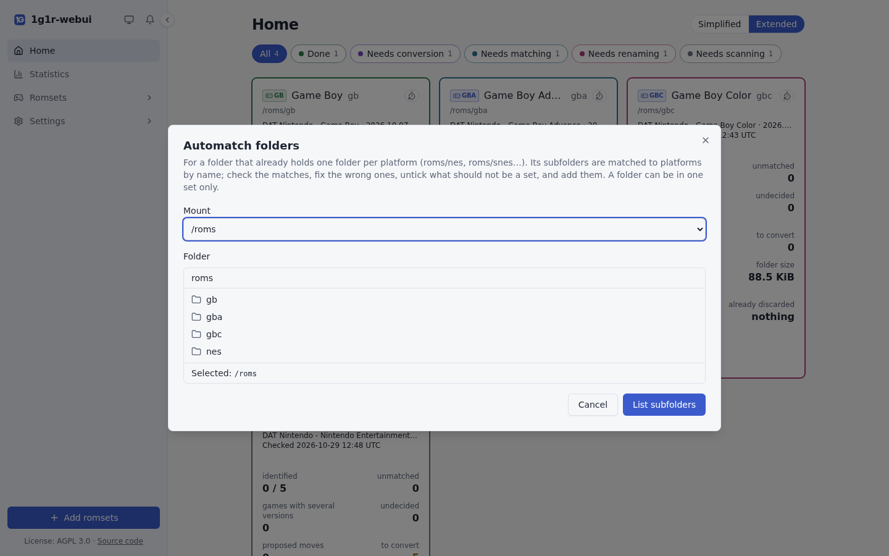
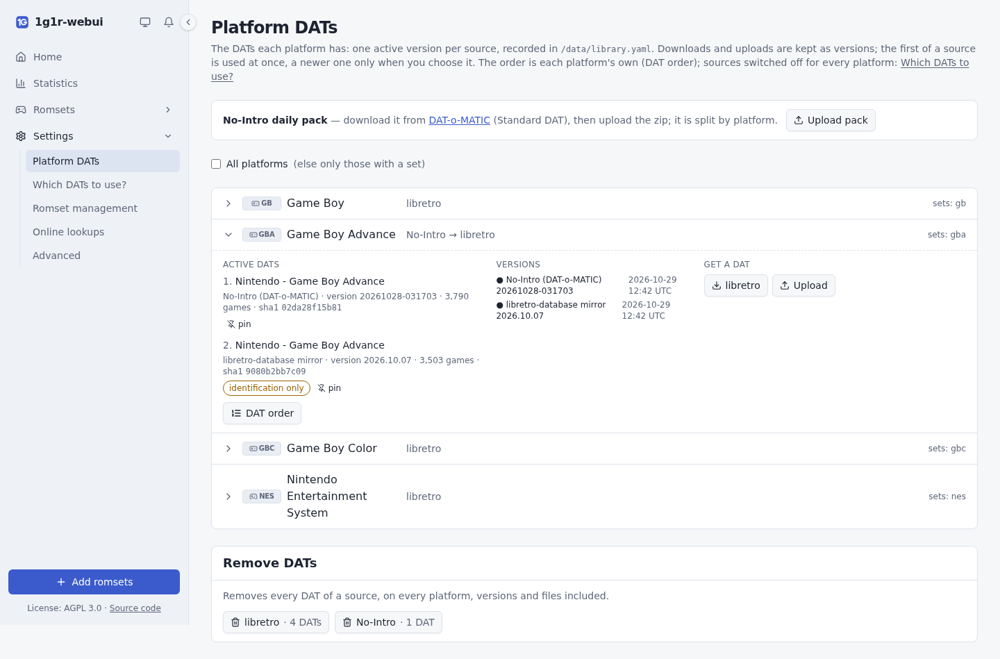
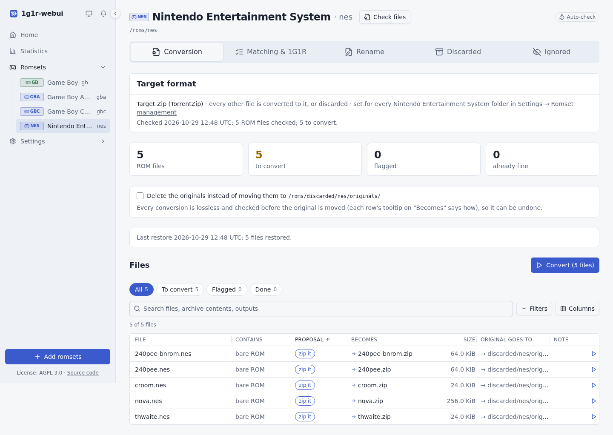
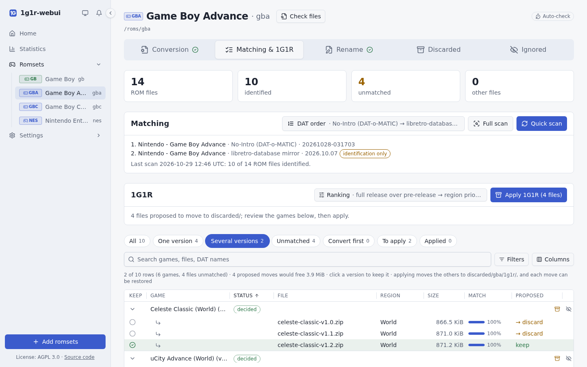
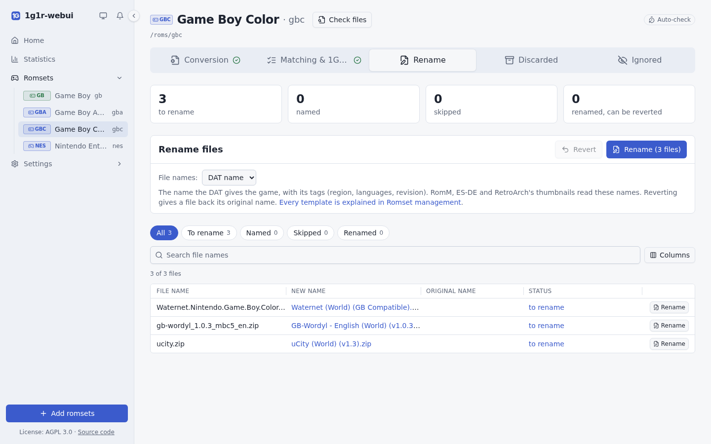
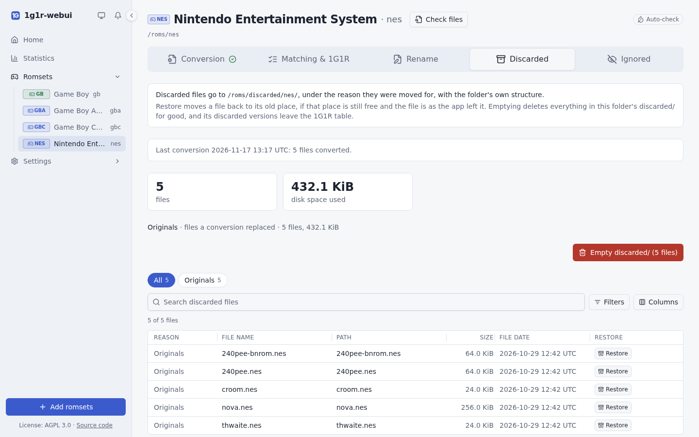

<div align="center">


<h3>1g1r-webui</h3>

Clean up your ROM folders in the browser: convert every file to one format per platform, identify it against No-Intro and Redump, and keep one version of each game.<br>
Every step is shown before it runs, and nothing is deleted unless you ask.

[Getting started](docs/user-guide/getting-started.md) ·
[Conversion](docs/user-guide/conversion.md) ·
[Matching & 1G1R](docs/user-guide/matching-and-1g1r.md) ·
[Renaming](docs/user-guide/renaming.md) ·
[DATs](docs/user-guide/dats.md) ·
[Discarded](docs/user-guide/discarded.md)

</div>

<picture>
  <source media="(prefers-color-scheme: dark)" srcset="docs/assets/home-dark.png">
  
</picture>

## What it does

- **Convert**: one lossless format per platform (zip, CHD, RVZ, NSP, decrypted 3DS). Each output is verified before the original is moved away.
- **Identify**: checksums against No-Intro, Redump, TOSEC and FBNeo DATs, several per platform, in the order you choose. [Hasheous](https://hasheous.org) can look up the rest (off by default).
- **1G1R** (one game, one ROM): keeps one version per game, picked by region, language and revision. When the ranking cannot decide, you pick.
- **Rename** (optional): to DAT names or clean titles. Revert is always possible.
- **Undo**: removed files go to a `discarded/` folder and come back with one click.

## Install

You need Docker with Compose.

```sh
git clone https://github.com/joaopn/1g1r-webui && cd 1g1r-webui
ROMS=/path/to/roms docker compose up -d --build
```

Open http://localhost:8077.

`ROMS` is the folder holding your ROMs, ideally one folder per platform:

```
roms/
├── gba/
├── nes/
├── psx/
└── discarded/    created by the app
```

To keep settings, put them in a `.env` file next to `compose.yaml`:

| Variable | Default | |
|---|---|---|
| `ROMS` | (required) | your ROM folder |
| `PORT` | `8077` | port of the web UI |
| `PUID`, `PGID` | `1000` | user and group that own your ROM files |

ROMs on another disk: add a line under `volumes:` in `compose.yaml`, mounted under `/mnt/<name>`:

```yaml
      - /mnt/disk2/roms:/mnt/disk2
```

The database, DATs and caches are kept in `data/` inside the clone.

**Update:** `git pull && docker compose up -d --build`

## How it works

A guided tour points to each step on first start.

**1. Add your folders.** **Add romsets** in the sidebar: one platform folder, or a folder of platform folders matched automatically.



**2. Get the DATs.** **Settings → Platform DATs**. Most are one click.



**3. Convert.** On the set's **Conversion** tab: **Check files**, review, **Convert**.



**4. Match and 1G1R.** On the **Matching & 1G1R** tab: **Scan**, check the proposed versions, **Apply 1G1R**.



**5. Rename** (optional, off by default). Pick a naming template on the **Rename** tab.



Changed your mind? The **Discarded** tab restores any file.



More in the [user guide](docs/user-guide/getting-started.md).

## Supported platforms

Files can be bare or inside `.zip`/`.7z`. Anything not in the target format is converted first; what cannot be converted can be moved to `discarded/`. Targets can be changed per platform in Settings.

<details>
<summary>37 platforms</summary>

| Platform | Formats | Target | DAT |
|---|---|---|---|
| Amiga | `ipf`; with TOSEC also `adf`, `adz`, `dms`, `lha`, `exe`, `hdf` | zip | No-Intro or TOSEC |
| Atari 2600 | `a26`, `bin` | zip | No-Intro |
| Atari 5200 | `a52`, `bin` | zip | No-Intro |
| Atari 7800 | `a78`, `bin` | zip | No-Intro |
| Atari Jaguar | `j64`, `jag`, `rom`, `abs`, `cof` | zip | No-Intro |
| Atari Lynx | `lnx`, `lyx`, `bll` (aftermarket executables) | zip | No-Intro |
| ColecoVision | `col`, `rom`, `bin` | zip | No-Intro |
| Commodore 64 | `crt`, `d64`; with TOSEC also `d71`, `d81`, `g64`, `nib`, `t64`, `tap`, `prg`, `p00`, `lnx` | zip | No-Intro or TOSEC |
| Dreamcast | `chd`, `cue`/`bin`, `gdi`; `cdi` cannot be converted (chdman cannot read it) | chd | Redump, Non-Redump, TOSEC |
| Game Boy | `gb` | zip | No-Intro |
| Game Boy Advance | `gba` | zip | No-Intro |
| Game Boy Color | `gbc` | zip | No-Intro |
| Game Gear | `gg`, `sms` (carts that run in Master System mode) | zip | No-Intro |
| GameCube | `rvz`, `iso`, `gcm` | rvz | Redump, Non-Redump |
| Master System | `sms` | zip | No-Intro |
| Mega Drive / Genesis | `md`, `gen`, `bin`, `smd` | zip | No-Intro |
| Neo Geo CD | `chd`, `cue`/`bin`, `iso` | chd | Redump |
| Neo Geo MVS | romset zips | zip | FBNeo |
| Neo Geo Pocket | `ngp` | zip | No-Intro |
| Neo Geo Pocket Color | `ngc`, `ngpc` | zip | No-Intro |
| Nintendo 3DS | `3ds`, `cci`, `cia` | bare file (decrypted) | No-Intro, New 3DS |
| Nintendo 64 | `z64`, `v64`, `n64` | zip (`z64`) | No-Intro |
| Nintendo DS | `nds` | zip | No-Intro |
| NES | `nes` | zip | No-Intro |
| Nintendo Switch | `nsp`, `nsz` | `nsp` | none, title ID |
| PC Engine / TurboGrafx-16 | `pce`, `sgx` | zip | No-Intro, SuperGrafx |
| PlayStation | `chd`, `cue`/`bin`, `iso` | chd | Redump, Non-Redump |
| PlayStation 2 | `chd`, `cue`/`bin`, `iso`, `cso` | chd | Redump, Non-Redump |
| PlayStation Portable | `chd`, `iso`, `cso` | chd | Redump, Non-Redump, PSN |
| Saturn | `chd`, `cue`/`bin`, `iso` | chd | Redump, Non-Redump |
| Sega 32X | `32x`, `bin` | zip | No-Intro |
| Sega CD | `chd`, `cue`/`bin`, `iso` | chd | Redump, Non-Redump |
| Super Nintendo | `sfc`, `smc` | zip | No-Intro |
| Virtual Boy | `vb` | zip | No-Intro |
| Wii | `rvz`, `iso`, `wbfs` | rvz | Redump, Non-Redump |
| WonderSwan | `ws` | zip | No-Intro |
| WonderSwan Color | `wsc` | zip | No-Intro |

</details>

Notes on some DATs and platforms: [DATs](docs/user-guide/dats.md), [3DS and Switch](docs/user-guide/3ds-and-switch.md).

The app ships no ROMs and no console keys. Use dumps and keys from hardware you own.

## Built on

| | Used for |
|---|---|
| [igir](https://igir.io) 5.8.0 | checksum matching against DATs, reading archives and disc images |
| chdman (MAME) 0.276 | CHD creation and verification |
| [dolphin-tool](https://github.com/emmercm/dolphin-tool-js) 0.2606.2 | RVZ conversion and verification |
| 7-Zip 25.01 | unpacking archives |
| [Retool](https://github.com/unexpectedpanda/retool) 2.4.9 clone lists | grouping versions of a game |
| [pyctr](https://github.com/ihaveamac/pyctr) | 3DS decryption |
| No-Intro, Redump, FBNeo, TOSEC DATs | identification |
| [Hasheous](https://hasheous.org) | optional lookup for files the DATs do not know |

## License

AGPL-3.0.
