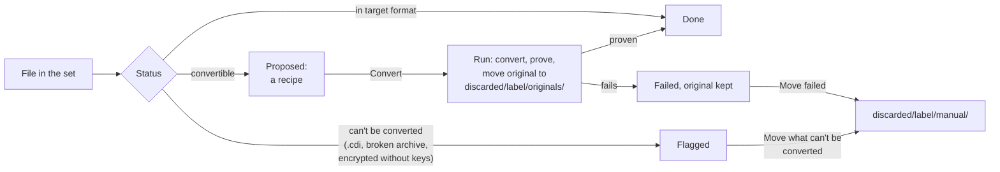

# Conversion

Every platform has one target format: zip, CHD, RVZ, NSP or the bare file. The README has the full table, and the target can be changed per platform in Romset management. Every file not in the target format is either converted or, if it can't be, moved to `discarded/`. Matching and 1G1R stay blocked until every file is in the target format, and nothing is checksummed before that.

## Recipes and their proof

A converted file is kept only if it is proven to hold the same data as the original. Otherwise the output is deleted and the original stays.

| Recipe | From → to | Proof |
|---|---|---|
| wrap | bare ROM → zip | the new zip is read again: its member's name, size and CRC32 equal the ROM's |
| unwrap | archived ROM → bare file (bare-file targets) | the extracted ROM's size and CRC32 equal what the scan listed |
| repack | 7z (or other archive) → zip | zip members checked one-to-one (name, size, CRC32) against a fresh listing |
| disc | cue/bin, gdi, iso, cso → CHD | `chdman verify`, then the tracks extracted again and compared with the originals |
| disc | iso, gcm → RVZ | `dolphin-tool verify` SHA1 equals the image's SHA1 |
| byteswap | N64 `.v64`/`.n64` → `.z64` | the output is read back and swapped again, and must equal the original (byte order comes from the file's magic bytes, not the extension) |
| decrypt | encrypted 3DS → decrypted `.3ds` | the image's own partition hashes (no DAT needed); needs the user's boot9/seeddb |
| nsp | NSZ → NSP | each NCA's hash equals its content ID |

Images already stripped of data (`.wbfs`, `.ciso`, NKit) are flagged and never converted further. CD tracks that aren't a whole number of sectors (patched translations) are padded with zeros so chdman keeps every byte, and the run reports a warning. If the padding isn't acceptable, the file can be removed.

## Runs

- A conversion runs a set's files on several workers ("Parallel conversions" in Advanced). Each worker takes one ROM through the whole pipeline. Only one set converts at a time: other sets wait their turn, because each run checks free space for itself.
- Unpacked temporary data is deleted as soon as it is no longer needed.
- A run doesn't stop at the first failure. It goes through every file and lists the ones that failed.
- **Stop** (Home card or the run panel): finished files are kept, and files in progress have their outputs deleted.
- Originals go to `discarded/<label>/originals/`, and restoring one restores the whole conversion. A per-set option (off by default) deletes the originals instead.

## Decisions

**Conversion is one-way and comes first.** It is lossless and proven, so later steps (identification, 1G1R) only ever see one format. Converting versions that 1G1R later discards is accepted, because 1G1R comes later and can be undone.

**No keep-as-is formats.** If a file can be converted, it is. What can't be converted (a `.cdi`, which chdman can't read) is discarded, not kept.

In the user guide: [Conversion](../user-guide/conversion.md)
