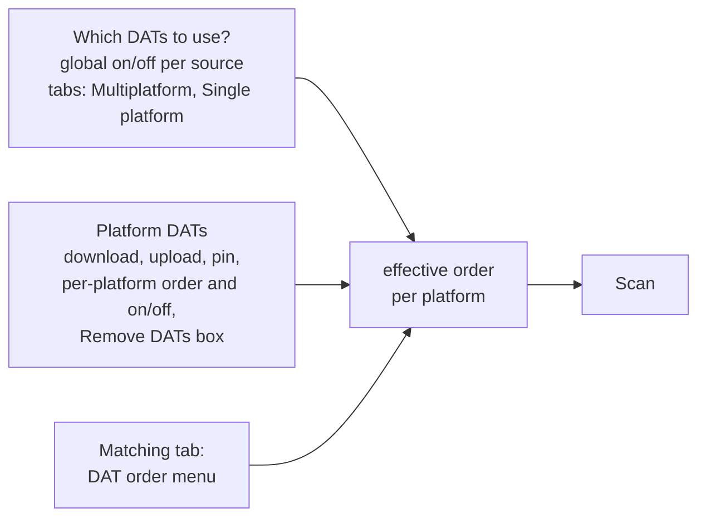

# DAT sources

DATs say which files are good dumps and what they're called. Each platform keeps one active DAT per source, plus an order. A Scan tries the DATs in that order (see [Matching & 1G1R](matching-and-1g1r.md)).

## Sources

| Source | Where it comes from | Notes |
|---|---|---|
| No-Intro | uploaded (DAT-o-MATIC file or daily pack) | full parent/clone data |
| Upload | any Logiqx/ClrMamePro file | |
| Redump | downloaded from redump.info | disc platforms |
| Non-Redump | No-Intro's disc DATs, uploaded | a button opens DAT-o-MATIC's page, because its download can't be scripted |
| PSN | libretro mirror | PSP digital-only releases |
| SuperGrafx | libretro mirror | PC Engine HuCards that No-Intro's PC Engine DAT leaves out |
| New 3DS | libretro mirror | New 3DS-only cards |
| FBNeo | downloaded from FBNeo's GitHub | Neo Geo MVS romsets |
| libretro | libretro-database mirror | identifies only: no parent/clone data, one ROM per game |
| TOSEC | tosecdev.org's complete pack, downloaded (or uploaded) and split per platform | Amiga, C64, Dreamcast |
| titledb | downloaded region files | Switch only, by title ID (see [Switch](switch.md)) |
| Hasheous | online lookup, not a DAT | placed in the same order, last by default |

PSN, SuperGrafx, New 3DS and Non-Redump are **side sets**: they're offered only on the platforms that have one.

## Settings pages

- **Platform DATs** is the first Settings page. By default it lists only platforms that have a set (a checkbox shows all). Each platform has its own sources, versions, pins and order. The **Remove DATs** box at the end removes one source from every platform.
- **Which DATs to use?** only holds switches: a source turned off there is off on every platform. Hasheous is switched in Online lookups instead.

## Decisions

**Per-platform priority list, with a default.** Every platform starts from the default order and can have its own.

**The libretro mirror is a fallback.** It keeps one ROM per game, so disc platforms download from redump.info, and multi-file No-Intro games need the full No-Intro DAT uploaded.

**Identification stays with igir.** igir's cache survives repeated runs with different DATs, so switching or adding a DAT re-matches without re-reading files.

In the user guide: [DATs](../user-guide/dats.md)
