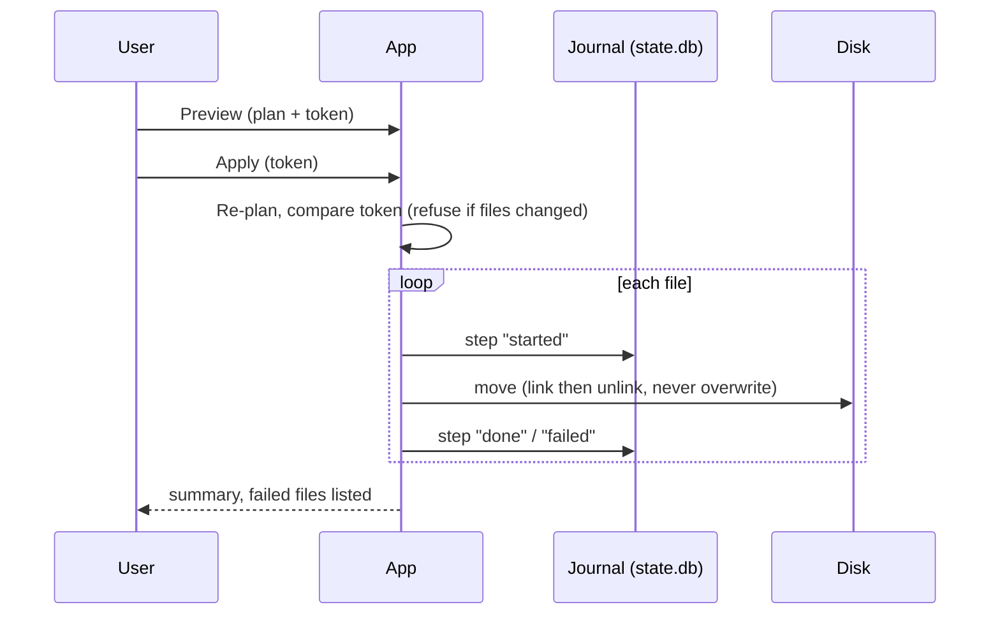

# Discarded and undo

By default nothing is deleted. Every file the app removes from a set is moved to `discarded/` inside the main ROM mount, under the set's label and a reason folder. Each move is recorded, and the Discarded tab restores it with one click.

## Layout

| Folder | What goes there | From |
|---|---|---|
| `discarded/<label>/1g1r/` | versions 1G1R didn't keep | Matching & 1G1R apply |
| `discarded/<label>/duplicates/` | identical copies of a kept version | Matching & 1G1R apply |
| `discarded/<label>/originals/` | originals of a conversion | Conversion |
| `discarded/<label>/manual/` | unmatched, unsupported or unconvertible files the user moved | Matching, Conversion |
| `discarded/<label>/updates/` | older Switch updates | Updates & DLC |

Inside each folder, files keep their path from the set.

## How a run works

- **Apply what was reviewed**: the token covers paths, sizes and modification times. If anything changed after the preview, the apply is refused.
- **No overwrites**: a move never replaces an existing file. Moves to another disk copy, check, then remove the source.
- **Runs go to the end**: a failed file is recorded and the run continues. The summary lists the failures.
- **Recovery**: after a crash or restart, steps marked started are settled from what is on disk. A step that can't be undone (a delete) is never completed by recovery: the file is kept.

## Restore and delete

- **Restore** (Discarded tab, per row or in bulk) moves files back. Restoring an original of a conversion brings back every original and removes the output, but only once all of them are back.
- **Guarded deletes**: deleting unmatched files, emptying `discarded/` for a set, and **Delete all discarded** on Statistics all show the full plan first and ask for typed confirmation ("DELETE ALL" for the last one).

## Decisions

**Discard is a trash can.** Nothing destructive happens without an explicit, reviewed apply step, and every step that can be undone is. Only an explicit, guarded delete removes data.

In the user guide: [Discarded](../user-guide/discarded.md)
