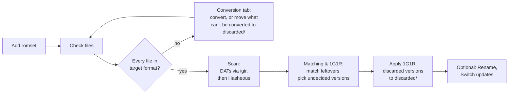
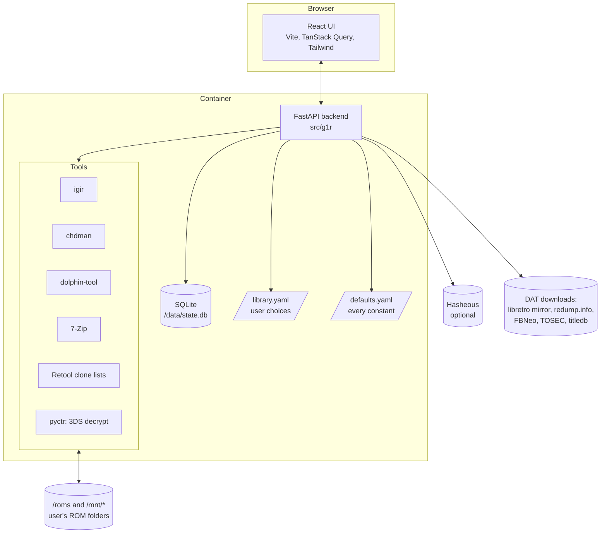

# Architecture

1g1r-webui is a self-hosted web UI, run with Docker Compose, that cleans up a ROM collection one folder at a time. Every file is first converted losslessly to its platform's target format, and files that can't be converted go to `discarded/`. What remains is identified by checksum against DATs (through igir), with Hasheous as an optional online fallback. Then one version of each game is kept (1G1R) and the others are moved to `discarded/`. Nothing is deleted by default, and every move can be undone.

## The flow, per set

Each step hands the next a simpler job: one format, then identification, then 1G1R. Deleting a game that was actually unique is the one failure that can't be accepted, so when the app is unsure it keeps the file.

## The container

One Docker container serves the web UI and the API on port 8077. The user mounts their ROM folder (and any other disks) and a `data/` folder. Everything else is in the image.

| Tool | Used for |
|---|---|
| igir | checksum matching against DATs; reads archives and CHDs. Shown live in the Matching box as a terminal render |
| chdman (MAME) | CD/DVD to CHD, and the round-trip check |
| dolphin-tool | GameCube/Wii to RVZ, and its verify |
| 7-Zip | listing and unpacking archives |
| Retool clone lists | which DAT entries are versions of one game |
| pyctr | 3DS decryption with the user's own keys |
| Hasheous | optional online lookup for files no DAT knows |

`docker run --rm <image> tool-versions` prints the versions in an image.

## Where things live

| Place | Holds | Who changes it |
|---|---|---|
| `compose.yaml` / `.env` | ROM mounts, port, PUID/PGID | the user |
| `/data/library.yaml` | sets, DAT choices, ranking, targets, every web UI setting | the web UI |
| `/data/state.db` | scans, file cache, identities, journal, notifications, caches | the app |
| `/data/dats/`, `/data/cache/` | DAT files, igir's per-folder cache | the app |
| `/data/keys/` | boot9, seeddb, prod.keys uploaded in the UI | the web UI |
| `defaults.yaml` (in the image) | every number, list and text the code uses | code changes only |

Every setting a user can change, and its default: [Settings](../user-guide/settings.md) in the user guide.

## Decisions

**Standalone, not a RomM add-on.** It runs on its own and only needs to be pointed at the ROM folders. The Rename tab and Switch game folders exist so that tools reading the library afterwards (RomM and other frontends) find names and layouts they understand.

**No hardcoded magic numbers.** Every constant (timeouts, column widths, page sizes, region lists) is in `defaults.yaml`. A test fails if source code contains a number other than 0 or 1. Every bound the UI shows comes from there too, and the API refuses values outside it.

**User settings live only in compose or the web UI.** There is no config file for the user to edit. Console keys are uploaded in the UI, so nothing needs mounting except the ROMs.

**igir does the identifying.** igir keeps a per-folder cache across runs with different DATs, so repeated scans don't re-hash. The app computes a hash itself only when no source already has it: to compare duplicates, for Hasheous, and for header-stripped checks.

**Runs are journaled.** Every file operation is recorded in the database before it happens, so a crash or restart can finish or roll back cleanly (see [Discarded and undo](discarded-and-undo.md)).

**Concurrency.** Scans run in parallel up to a limit set in Advanced. Conversions run one at a time across sets (each checks free space assuming no other conversion is writing), with parallel workers inside a run. Other runs (apply, restore, moves to `discarded/`) run one per set.
