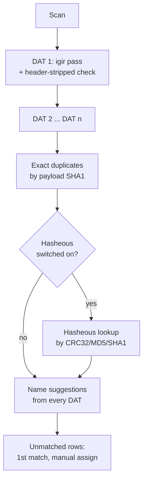
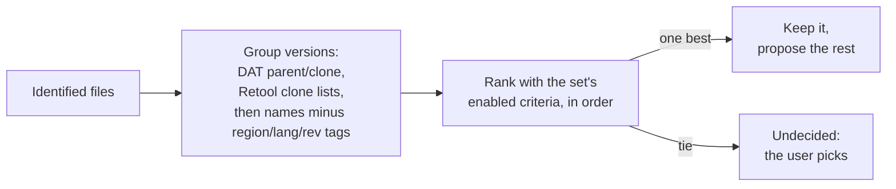

# Matching & 1G1R

The Matching & 1G1R tab identifies each file, groups versions of the same game, ranks them, and proposes which one to keep. The others are moved to `discarded/<label>/1g1r/` only after the user reviews and applies. It waits until every file is in the target format (see [Conversion](conversion.md)).

## Identification order

A Scan works through the platform's DAT order, and each step only sees files still unmatched:

| Method | How | Trusted for 1G1R |
|---|---|---|
| checksum | igir finds the file in a DAT | yes |
| headerless | header stripped (e.g. NES in a zip), then the DAT | yes |
| duplicate | identical bytes to an identified file | yes |
| Hasheous | online hash lookup; No-Intro/Redump names taken, other sources only when one of the platform's DATs lists the name | yes, as a single-file version |
| fuzzy | name similarity: suggested only; automatch is off unless the user sets a threshold | as a single-file version |
| manual | the user picks the DAT name | yes |

**Quick scan** reuses the app's file cache and igir's per-folder cache. **Full scan** deletes both. **Rematch unmatched** runs every source again, but only on files that are still unmatched (for when DATs were added). The Matching box shows the igir commands that are running, with igir's live progress bars.

## Unmatched files

They're rows in the same table. Each shows its **1st match** (the best suggestion and its score). Click rows to select them, then:

| Button | Acts on |
|---|---|
| Match exact name | files whose name (no folder, no extension) is exactly their 1st match |
| Match N to 1st | the selection |
| Move / Delete | the selection, else every row shown (delete is guarded) |
| Rematch unmatched | the whole set |

Clicking a file name copies it.

## Grouping and ranking

| Criterion | Prefers |
|---|---|
| prerelease | full release over pre-release |
| region | the region order (default World > USA > Europe > Japan) |
| language | the language order (default En) |
| revision | newest revision |
| original | original over re-release |
| parent | the DAT's parent over its clones |
| dump | clean dump over alternate, cracked, trained or bad (TOSEC) |

New sets start with prerelease, then region. Each set edits its own copy of the ranking on this tab. The kept version can be overridden on any line. The "Several versions" badge shows how many games are undecided.

**Apply 1G1R** shows the plan and applies exactly what was reviewed: if any file changed since, the apply is refused. Moves go to `discarded/<label>/1g1r/`, and identical copies of a kept version to `duplicates/`.

## Decisions

**Strict ranking, no tiebreak.** If the enabled criteria don't separate two versions, the game stays undecided. An alphabetical tiebreak would pick a version for no reason the user can see.

**A wrong join is the dangerous failure.** Joining two different games would discard a unique one. Missing a join only leaves a duplicate. So any tag the app doesn't understand (a publisher, "Bullet-Proof") keeps games apart, and Retool lists are looked up with those tags kept.

**Single-file identities never stand for a whole multi-ROM game.** Hasheous and fuzzy name one file. If that file is one disk of a multi-disk game, the version counts as incomplete and is never kept over a complete one. Archives with several ROMs are never looked up online.

**Hasheous is off by default.** Nothing leaves the machine unless the user switches it on in Online lookups.

In the user guide: [Matching & 1G1R](../user-guide/matching-and-1g1r.md)
