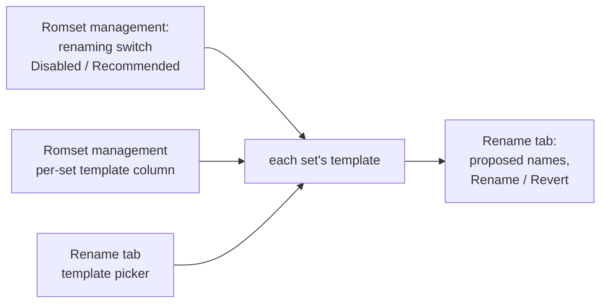

# Renaming

The Rename tab gives files names that the tools reading the library afterwards (RomM, ES-DE, RetroArch thumbnails) understand. Renaming starts **disabled** for every set. A revert always gives a file back the name it had before its first rename.

## Templates

| Template | Name | Example |
|---|---|---|
| Disabled | unchanged | |
| DAT name | the DAT's name with its tags | `Legend of Zelda, The - A Link to the Past (USA).sfc` |
| Clean title | the DAT name without tags (disc/side/tape/part kept) | `Legend of Zelda, The - A Link to the Past.sfc` |
| Switch (title ID) | `Name [ID][vN]`, DLC `Game [DLC name] [ID][vN]` | `Attack on Titan 2 [Additional Episode Second Victory] [010034500641B00C][v327680].nsp` |

Arcade sets (Neo Geo MVS) only offer Disabled, because emulators load them by set name.

## Where it's set

The Romset management badge reads **Disabled**, **Recommended** (each platform's default template) or **Custom** (some set was changed by hand). While renaming is on, files waiting for a new name keep the set from counting as done, and Home shows **Needs renaming**.

## What gets renamed

- Only files identified by checksum, header-stripped checksum, duplicate, title ID or a manual match. Names from Hasheous or fuzzy matching aren't trusted enough.
- A file with another operation pending (a conversion, a proposed move to `discarded/`) is skipped. The rest of the set can still be renamed.
- Characters that filesystems refuse become `_`. Only file names change, never folders.

## Decisions

**Names only, original kept.** The first name a file had is recorded, so a revert always works, even after several renames. There's no RomM-specific guard: which template fits their tools is the user's call.

In the user guide: [Renaming](../user-guide/renaming.md)
