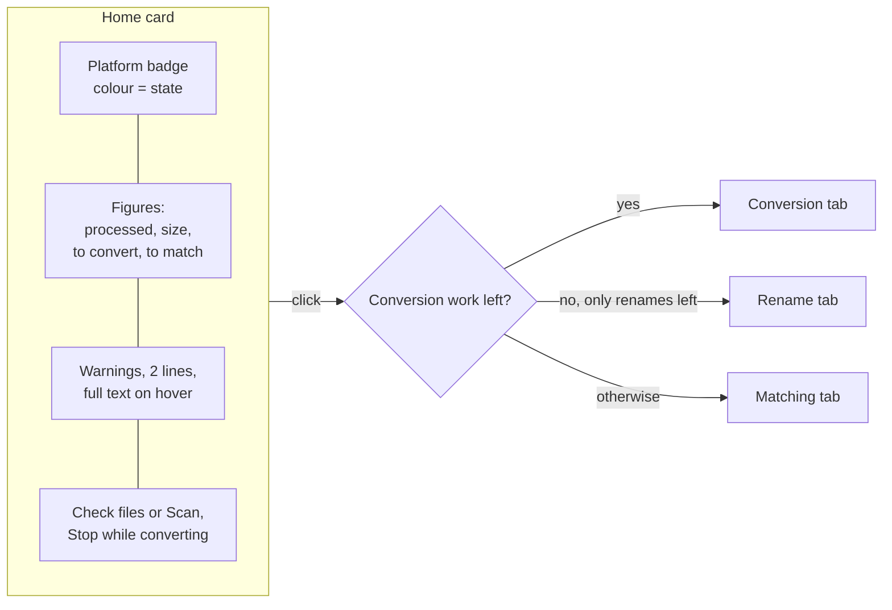

# Romsets

A romset (a "set") is one folder holding one platform. Two folders can have the same platform and are still handled separately: ranking, ignore lists, renaming and auto-check are all per set. The target format and the DAT order are per platform.

## Adding sets

The sidebar's **Add romsets** button offers:

- **Automatch folders**: lists the folders under the mounts and proposes a platform for each by exact name (platform id, short name, full name, DAT name, aliases; case, spaces and punctuation ignored). No fuzzy guessing, because a wrong platform is worse than none.
- **Add single folder**: pick a folder and a platform by hand.

A folder can only be one set. A folder nested inside a set (or holding one) is refused. Sets can be hidden or removed in Settings → Romset management. Removing a set touches no files.

## Home

| Badge (multi-select, All clears the others) | A set is in it when |
|---|---|
| Done | it has ROM files and every tab is done (green border) |
| Needs conversion | files are not in the target format, or can't be converted |
| Needs matching | files are unmatched, a game is undecided, or a move is proposed |
| Needs renaming | renaming is on and names would change |
| Needs scanning | never scanned, last scan failed, the active DAT changed, or Check files found files no Scan has read |

The platform badge's colour gives the set's state everywhere it appears: red for an error, yellow for a warning, green for done, blue for work left. While a scan or conversion runs, the card's background fills up as a progress bar. Home has a Simplified and an Extended view, with the same card size.

## Check files and Scan

| | Check files | Scan |
|---|---|---|
| What | looks for new, changed and gone files | reads the files (checksums) and identifies them |
| Reads | listings, archive members, headers | file contents (via igir, plus the app's own hashes when needed) |
| Where | set header, next to the set's name; Home card | Matching tab, Home card once a check found something |
| Result | "Nothing new", or the set now needs a Scan | identities, the Matching table |

**Auto-check** (off by default, per set): a badge on the card and the set header turns it on. A background job then runs Check files whenever the set's last check or scan is older than the interval set in Advanced (default 1440 minutes, one day). Auto-checks that find nothing are left out of notifications.

## Set page tabs

Conversion · Matching & 1G1R · Updates & DLC (Switch only) · Rename · Discarded · Ignored. A tab with nothing left to do shows a green check.

**Ignored**: per-set patterns (the defaults hide clutter such as `Thumbs.db` and `*.txt`) and exact files. In the "file not supported" box, the buttons on each row add the file, or its format, to the list. Saving starts a Check files run.

## Decisions

**One folder, one platform, handled in isolation.** This keeps ranking and cleanup decisions local to a folder the user can see.

**Platforms are whitelisted.** Only the formats in the README's table are handled. Other files are listed as unsupported, and they can be ignored or moved to `discarded/` (reviewed, restorable).

In the user guide: [Getting started](../user-guide/getting-started.md)
