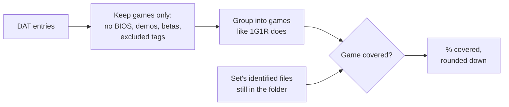

# Statistics

Statistics, below Home in the sidebar, shows how much of each DAT a set covers.

| Column | Shows |
|---|---|
| Romset | the set, its identified / ROM files, with a faint bar |
| Size | the set's size on disk |
| Discarded | the size of its `discarded/` |
| Platform | the platform badge |
| DATs | one block per DAT source: a bar, then the source's name and its % |

- Clicking a percentage opens the **missing games** of that DAT, with what the DAT knows about each (year, publisher, regions, languages, serial, notes). Values of different versions are joined with commas.
- The Romset and Size cells open the set's next step: Conversion if conversion work is left, else Rename when only renames are left, otherwise Matching. Discarded opens the Discarded tab.
- A collapsed **DAT info** section lists the sources and explains what counts.

## What counts

Only games count: entries outside the DAT's Games category, and entries tagged as demo, beta, prototype, BIOS, hack and the like (`statistics:` in `defaults.yaml`), are left out before grouping. Unlicensed releases count. A game is covered when a file in the set is one of its remaining versions in this DAT, or when the file's checksums cover every ROM of the game. A left-out version never covers a game, and discarded files don't count. A percentage is rounded down, so only a complete DAT reads 100%. On Switch, titledb's region files count together as one source.

## Cache and actions

Figures are cached on the server. When a set changes, the page marks it "changed" instead of recomputing. **Refresh** recomputes everything. **Delete all discarded** empties `discarded/` for every listed set after a full review and the typed confirmation "DELETE ALL".

In the user guide: [Statistics](../user-guide/statistics.md)
