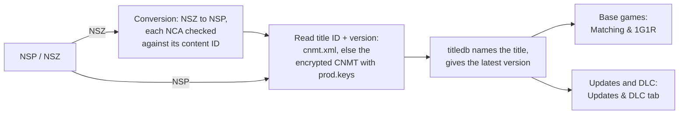

# Switch

There's no public checksum DAT for Switch, so a Switch set works by **title ID**. The title ID and version are read from inside each NSP. The file name is never trusted, because names are arbitrary. Base games, updates and DLC are separate files, and 1G1R only ranks base games.

## Formats

| Format | Handled |
|---|---|
| NSP | target format |
| NSZ | converted to NSP |
| XCI, XCZ | not supported (a little-used format, never tested on real dumps) |

## titledb

titledb's region files serve as Switch's "DATs". Each region file is its own source, after every other DAT. One-click downloads are offered for US.en and JP.ja (JP.en is nearly empty), and a list offers the other regions. titledb also gives each title's latest version and its expected content IDs. These show up as notes in the Flags column when a file is missing content.

## Updates & DLC tab

- One row per game. A game with updates or DLC has a chevron. Groups start closed, except yellow games.
- Game colours: **yellow** means an older update can be discarded, **blue** means not on titledb's latest version, **green** means latest.
- **Discard old updates** proposes every update except the newest per game, unless the user marked one Keep (for example for mod compatibility). The moves go to `discarded/<label>/updates/`. DLC is always kept.
- **Quick scan** in the same box rechecks updates without checksumming anything.
- **prod.keys** (optional, uploaded on the tab) lets the app read versions from NSPs that have no `cnmt.xml`. Without keys, those versions show as unreadable, with a warning.
- The tab counts as done when nothing is left to discard. A newer version existing online doesn't count against it.

## Game folders (optional)

A box on the Updates & DLC tab moves each game into its own folder, with `update/` and `dlc/` subfolders (the layout RomM expects for a game made of several files). It's reversible, and it never affects whether the set counts as done.

## Decisions

**No automatic pick between base files of one title.** Two base files with the same title ID are copies, and the user chooses between them, even when they're byte-identical.

**Updates are kept by 1G1R and cleaned on their own tab.** Some users keep older updates on purpose, so dropping them is a separate, optional step.

In the user guide: [3DS and Switch](../user-guide/3ds-and-switch.md)
