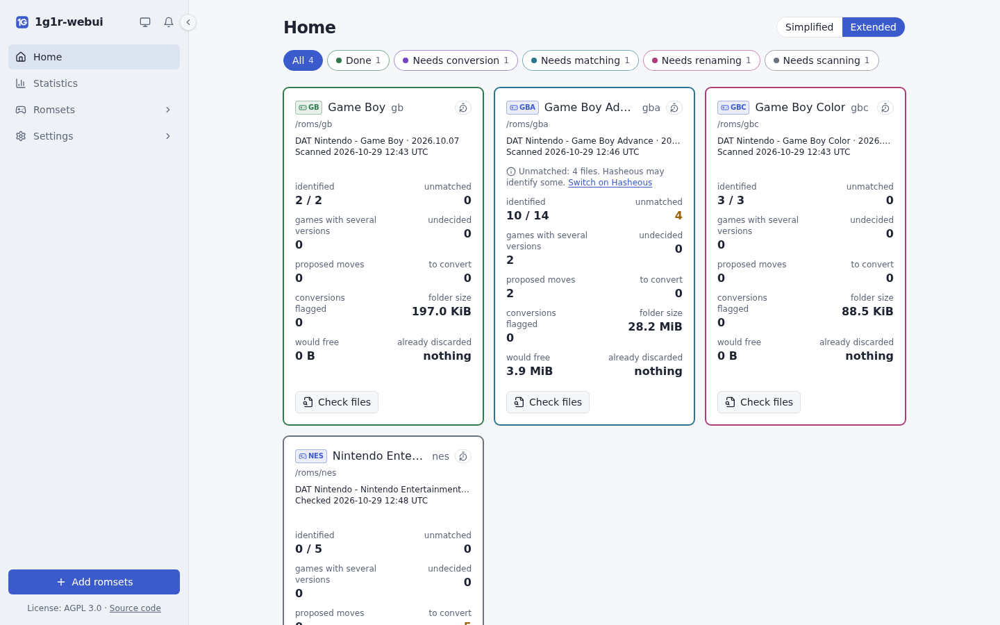

#  1g1r-webui

Convert, identify and 1G1R your ROM folders in the browser. Nothing is deleted unless you ask.

- **[Convert](user-guide/conversion.md)**: one lossless format per platform, verified before the original moves.
- **[Identify](user-guide/matching-and-1g1r.md)**: DAT checksums, with [Hasheous](https://hasheous.org) as an option.
- **[1G1R](user-guide/matching-and-1g1r.md)**: one version per game, by region, language and revision.
- **[Rename](user-guide/renaming.md)** (optional): DAT names or clean titles, always revertible.
- **[Undo](user-guide/discarded.md)**: removed files go to `discarded/` and come back with one click.

<picture><source media="(prefers-color-scheme: dark)" srcset="assets/home-dark.png"></picture>

Runs in Docker: see [Getting started](user-guide/getting-started.md).

## User guide

1. **[Getting started](user-guide/getting-started.md)** — Installation, adding romsets and DATs, the order of the steps.
2. **[Conversion](user-guide/conversion.md)** — Check files, converting to the platform's target format, stopping a run.
3. **[Matching & 1G1R](user-guide/matching-and-1g1r.md)** — Scan, picking one version per game, matching unidentified files.
4. **[Renaming](user-guide/renaming.md)** — Naming templates and revert.
5. **[DATs](user-guide/dats.md)** — Downloading, uploading and ordering DATs per platform; the extra sources.
6. **[Discarded](user-guide/discarded.md)** — The `discarded/` folder, restoring files, deleting for good.
7. **[3DS and Switch](user-guide/3ds-and-switch.md)** — Console keys, 3DS decryption, Switch title IDs, updates and DLC.
8. **[Statistics](user-guide/statistics.md)** — How much of each DAT a set covers, and the missing games.
9. **[Settings](user-guide/settings.md)** — `compose.yaml` settings, the Settings pages, and per-set options.

## Architecture

How the app works and why, for contributors and the curious.

- **[Overview](architecture/index.md)** — The flow per set, the container, and where things live.
- **[Romsets](architecture/romsets.md)** — Adding sets, Home cards and badges, Check files and Scan, set page tabs.
- **[Conversion](architecture/conversion.md)** — Target formats, conversion recipes and how each output is proven.
- **[Matching & 1G1R](architecture/matching-and-1g1r.md)** — Identification order, unmatched files, grouping and ranking.
- **[DAT sources](architecture/dat-sources.md)** — Each source, where it comes from, and how the DAT order is set.
- **[Discarded and undo](architecture/discarded-and-undo.md)** — The `discarded/` layout, how a run applies, restore and delete.
- **[Switch](architecture/switch.md)** — Title IDs, titledb, the Updates & DLC tab, game folders.
- **[Renaming](architecture/renaming.md)** — Templates, where they are set, and which files get renamed.
- **[Statistics](architecture/statistics.md)** — What counts as covered, the cache and the actions.
