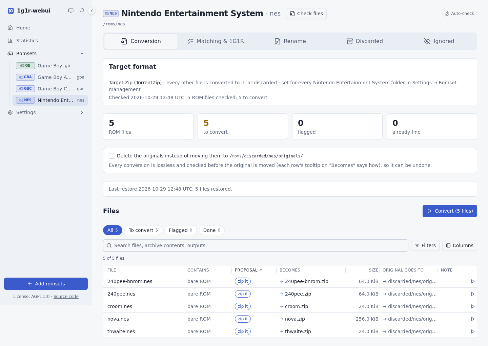
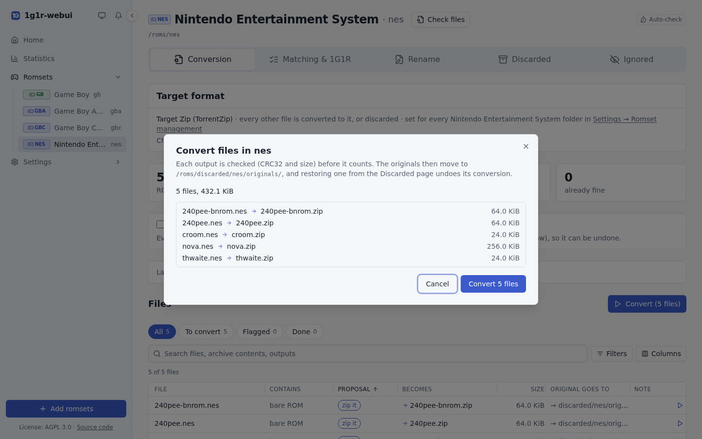
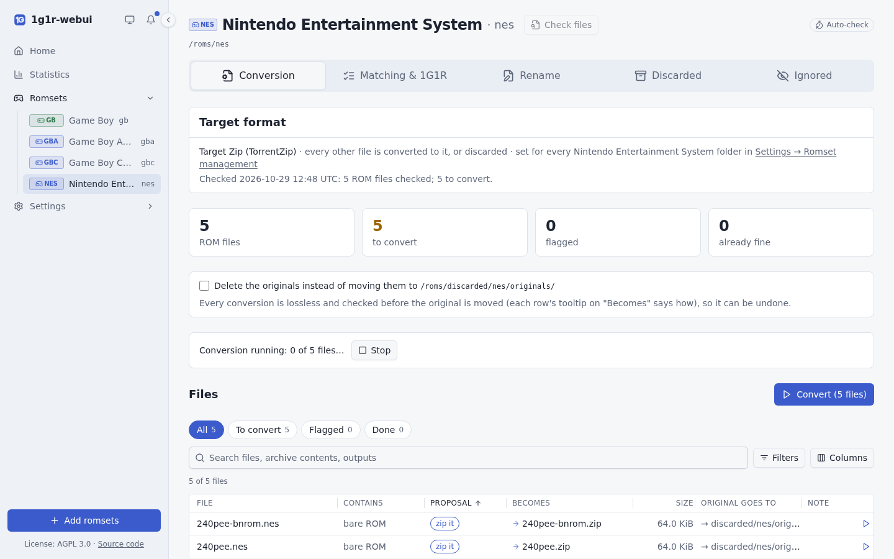

# Conversion

Each platform has one target format. Everything else is converted to it first; matching waits until it is done.

**Check files** (next to the set name) lists the set and what needs converting. Nothing is hashed.

**Convert** shows the plan. Each output is checked (CRC32 and size) before the original moves to `discarded/<set>/originals/`.

Runs can be stopped. Finished files are kept; the file in progress is removed.

Files that cannot be converted can be moved to `discarded/` from the same tab. The target is set per platform in **Settings → Romset management**.

How it works: [Conversion](../architecture/conversion.md)
