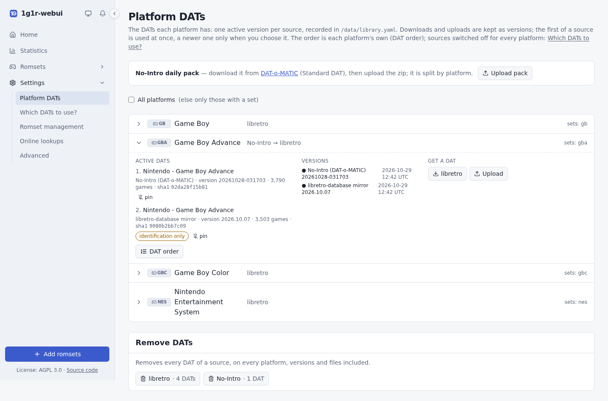
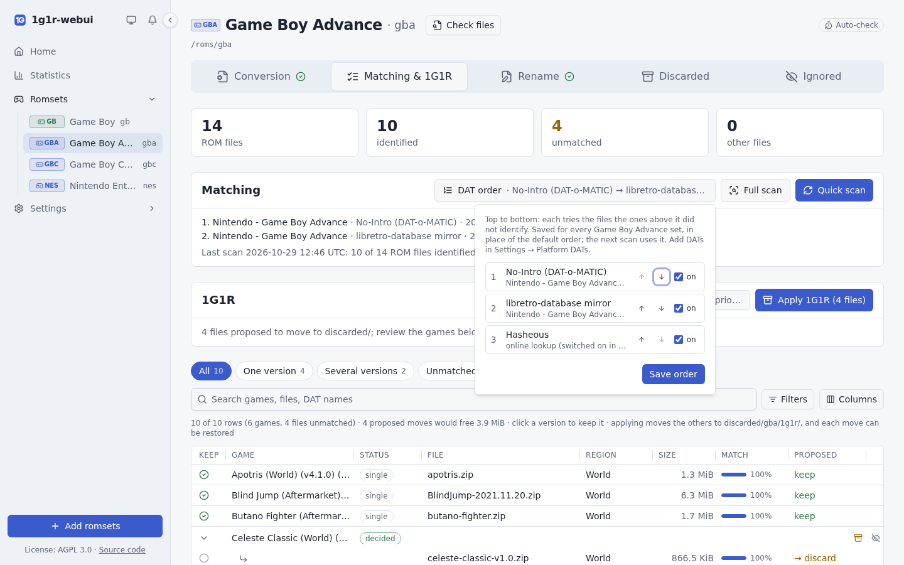
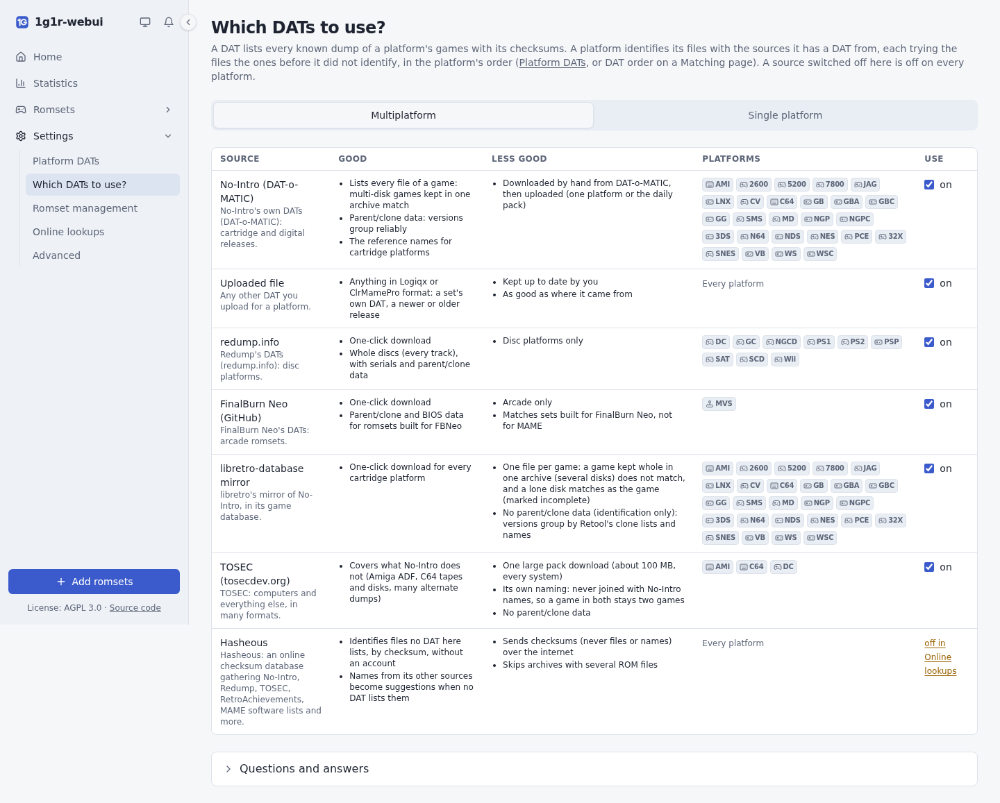

# DATs

**Settings → Platform DATs**: download, upload or pin DAT versions per platform.

A platform can use several DATs. Each tries the files the ones above it did not identify. The order is set per platform (**DAT order**).

**Settings → Which DATs to use?** switches sources on or off for every platform.

## Sources

- Non-Redump: No-Intro's DATs of discs Redump does not list (prototypes, betas, unlicensed). DAT-o-MATIC serves them to a browser only: the Non-Redump button in Settings → Platform DATs opens the page, then the file is uploaded there.
- PSN (PSP): No-Intro's DAT of digital-only releases, downloaded from the libretro-database mirror. Games kept as an EBOOT.PBP folder are not supported.
- SuperGrafx (PC Engine): No-Intro's DAT of the HuCards that need the SuperGrafx, which its PC Engine DAT leaves out, downloaded from the libretro-database mirror.
- New 3DS (3DS): No-Intro's DAT of the cards that need a New 3DS (Xenoblade Chronicles 3D, Fire Emblem Warriors), which its 3DS DAT leaves out, downloaded from the libretro-database mirror.

How it works: [DAT sources](../architecture/dat-sources.md)
