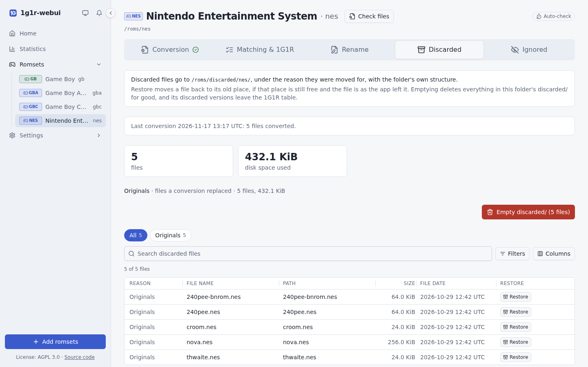

# Discarded

Nothing is deleted unless you ask. Discarded files go to `discarded/<set>/` in the ROM folder, by reason (`originals`, `1g1r`, `duplicates`, `manual`), with the set's folder structure.

**Restore** puts a file back. **Empty discarded/** deletes for good, behind a typed confirmation.

