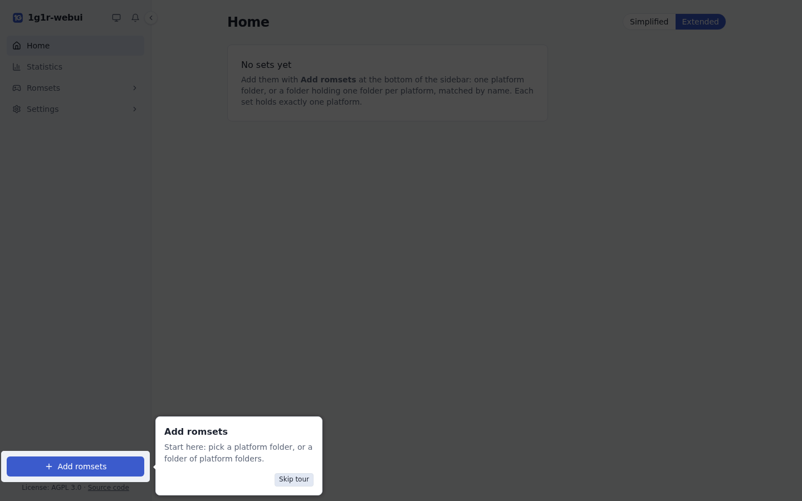
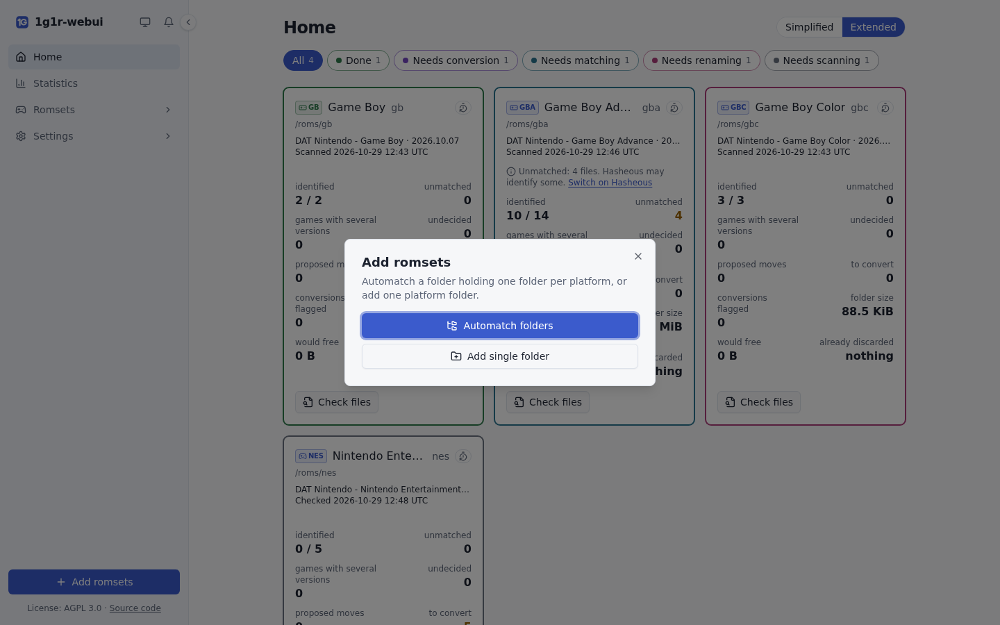
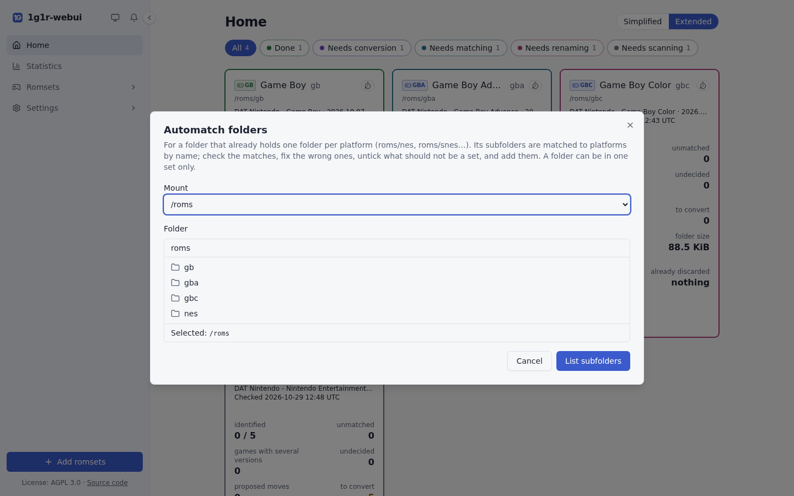
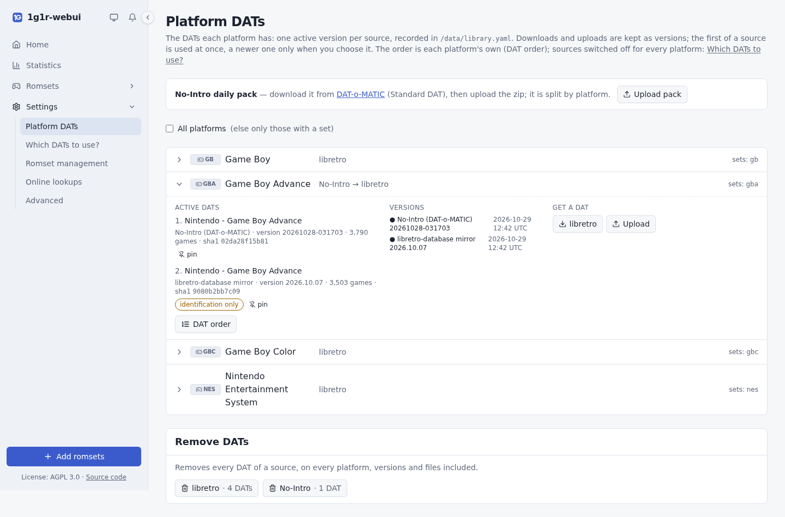
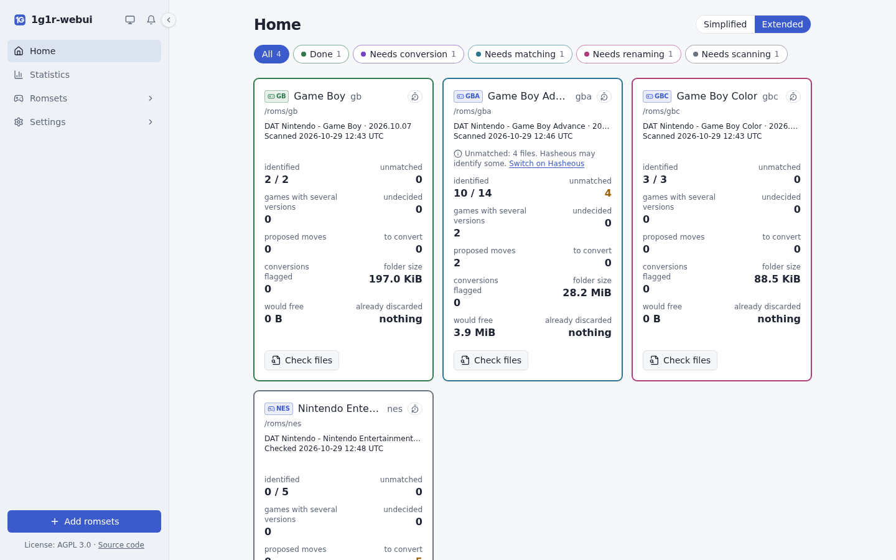
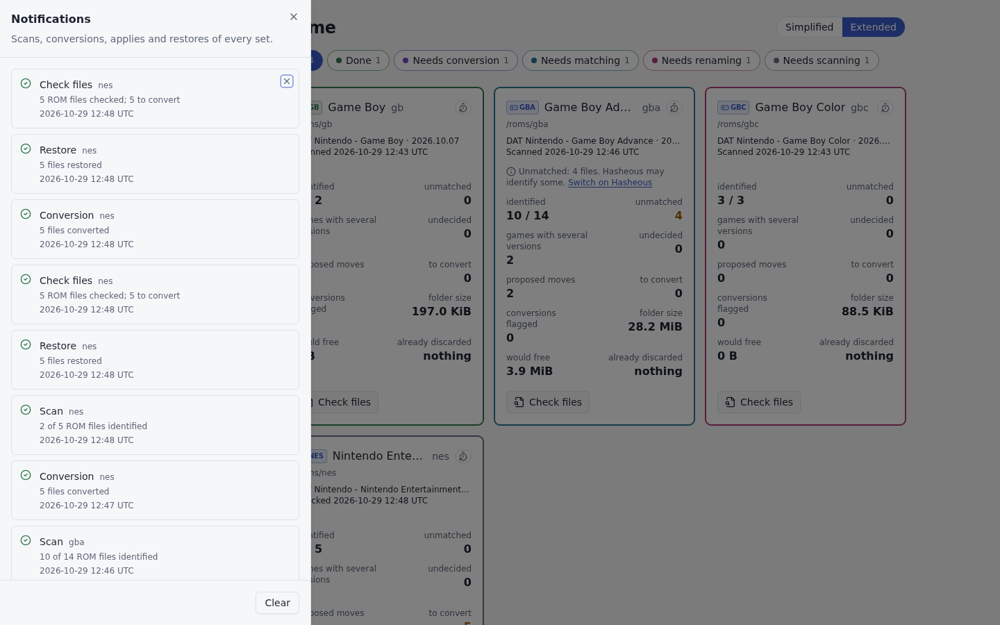

# Getting started

## Install

```sh
git clone <this repo> && cd 1g1r-webui
ROMS=/path/to/roms docker compose up -d --build    # http://localhost:8077
```

`ROMS` is mounted at `/roms`. Database, DATs, caches and keys go to `data/` in the clone.

## Add romsets

A set is one folder with one platform. The first run points you through the steps.



**Add romsets** → **Add single folder**, or **Automatch folders** for a folder of platform folders (`roms/nes`, `roms/snes`, …).





## Get DATs

**Settings → Platform DATs**. Most download with one click.



## Work through each set

Home shows what each set needs. **Check files** looks for new files; when it finds some, **Scan** takes its place. The auto-check badge on a card has the set checked by itself (interval in **Settings → Advanced**).



1. [Conversion](conversion.md)
2. [Matching & 1G1R](matching-and-1g1r.md)
3. [Renaming](renaming.md) (off by default)

Progress and results also show under the bell.


