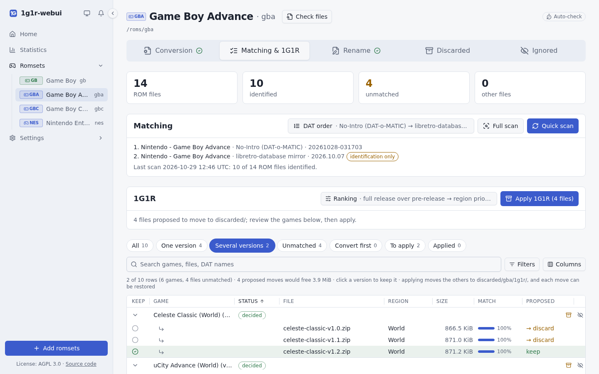
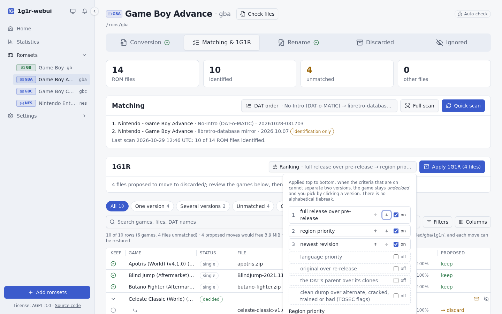
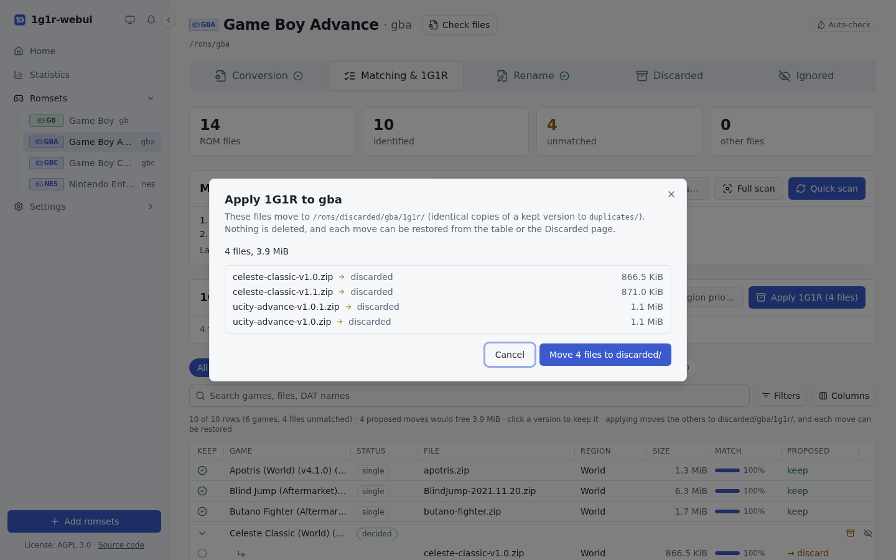
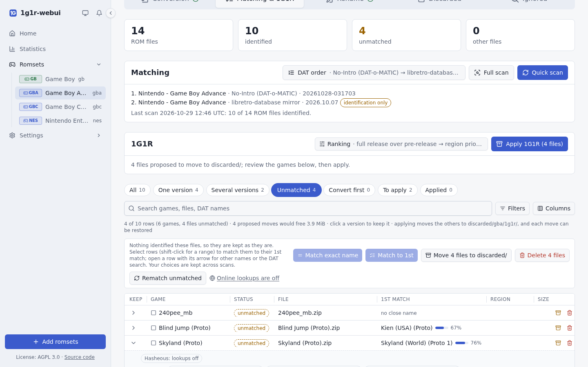

# Matching & 1G1R

## Scan

**Scan** identifies files against the platform's DATs, in [DAT order](dats.md). Checksums are cached; a quick scan reads only new and changed files. igir's commands and output show in the Matching box.

## Several versions

Versions of a game are ranked by region, language and revision. Ties stay undecided until you pick. Click a version to keep it instead.

**Ranking** sets the order for the set.

**Apply 1G1R** moves the other versions to `discarded/<set>/1g1r/`.

## Unmatched

Files no DAT knows. Each row shows the closest DAT names. **Match exact name** takes the 1st match when it equals the file name. Select rows and **Match to 1st**, open a row to pick another name, or **Rematch unmatched** after adding a DAT. [Hasheous](https://hasheous.org) can be switched on in **Settings → Online lookups**.

How it works: [Matching & 1G1R](../architecture/matching-and-1g1r.md)
