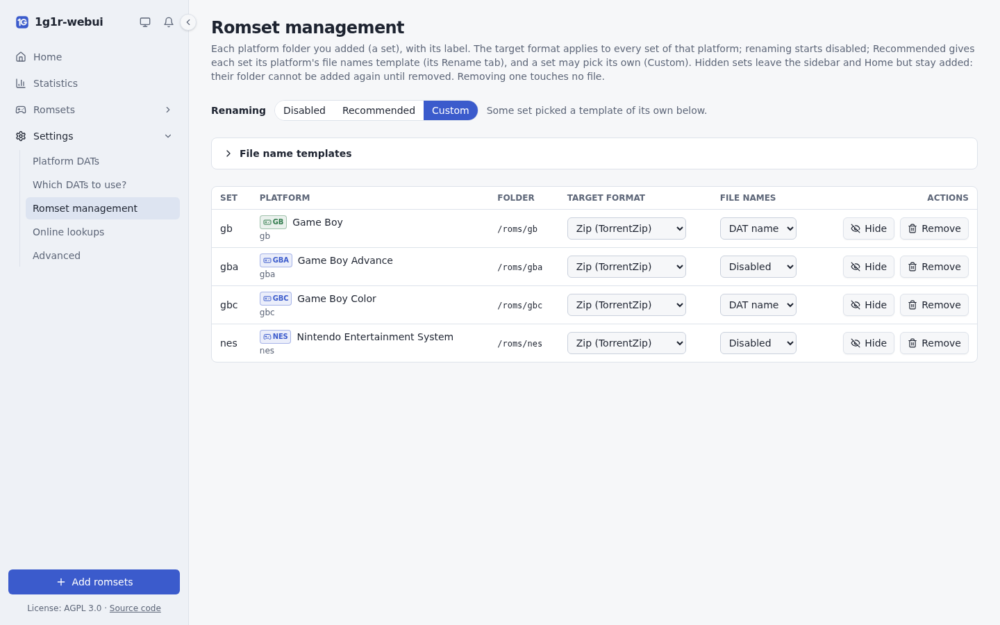
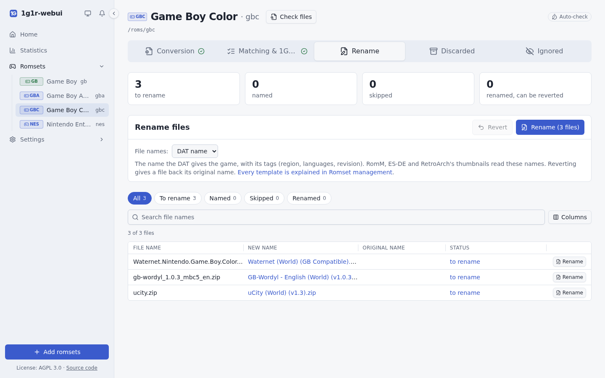
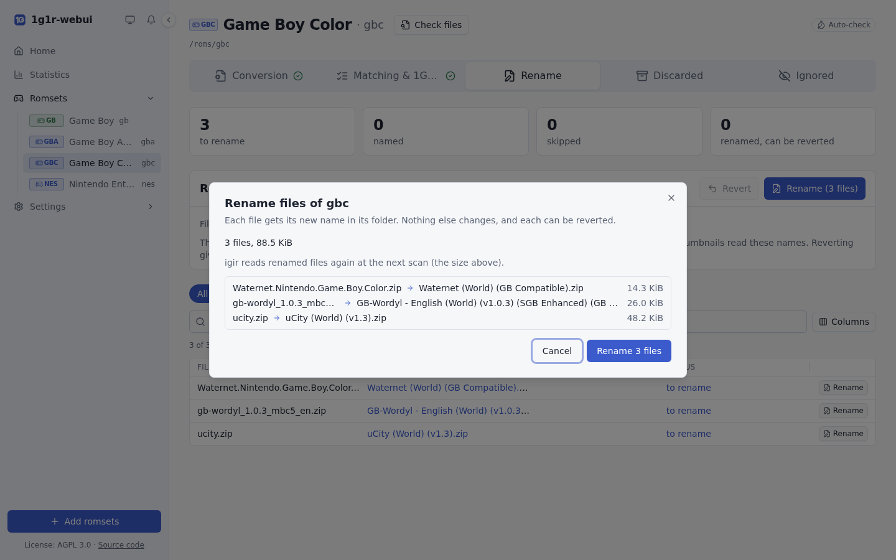

# Renaming

Off by default. Turn it on in **Settings → Romset management**, for every set or per set.

| Template | Result |
|---|---|
| DAT name | `uCity (World) (v1.3).zip` |
| Clean title | `uCity.zip` |
| Switch (title ID) | `Name [ID][vN].nsp` |
| Disabled | names stay as they are (every set starts here; recommended for arcade sets) |

Only identified files are renamed. The original name is kept, so **Revert** always works.

