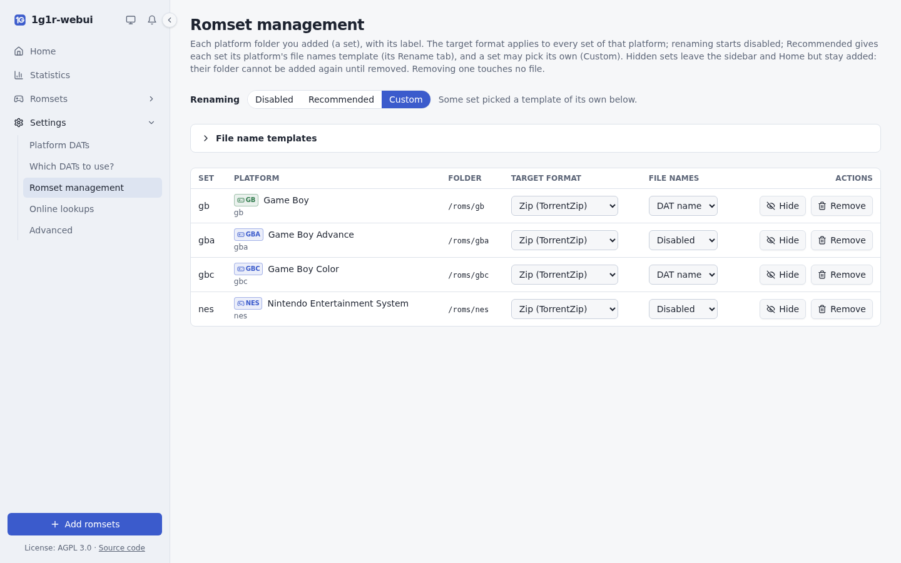

# Settings

Container settings are in `compose.yaml` or a `.env` next to it; everything else is in the web UI, saved to `/data/library.yaml`.

## compose.yaml / .env

| Setting | Default |
|---|---|
| `ROMS`: your ROM folder, mounted at `/roms` | required |
| More ROM folders: one volume line each, under `/mnt/<name>` | none |
| `PORT` | 8077 |
| `PUID` / `PGID`: owner of moved and converted files | 1000 / 1000 |

## Settings pages

| Page | Holds |
|---|---|
| Platform DATs | each platform's DATs: download, upload, pick or pin a version, DAT order; No-Intro daily pack upload; Remove DATs |
| Which DATs to use? | each source on or off for every platform |
| Romset management | per set: target format (shared by the platform's sets), file name template, hide, remove; renaming Disabled / Recommended |
| Online lookups | Hasheous on or off (off by default) |
| Advanced | parallel scans, parallel conversions, rows per page (50), auto-check interval (1440 minutes), igir threads per scan; the configuration in use |

## On the set pages

| Setting | Tab |
|---|---|
| Delete originals instead of moving them to `discarded/` | Conversion |
| Console keys (`boot9.bin`, `seeddb.bin`) | Conversion, 3DS sets |
| DAT order of the platform | Matching & 1G1R, next to Scan |
| Ranking: criteria, region and language priority | Matching & 1G1R |
| Kept version, manual matches | Matching & 1G1R table |
| `prod.keys`, keeping older updates | Updates & DLC |
| File name template | Rename |
| Ignored patterns and files | Ignored |
| Auto-check | badge on the set's title line, or its Home card |

View choices (Simplified/Extended, Home badges, sidebar, table columns, the tour) stay in each browser.

How it works: [Architecture](../architecture/index.md)
