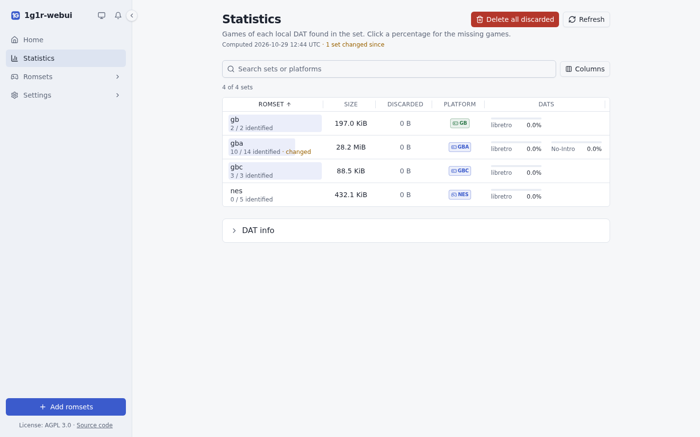

# Statistics

How much of each DAT a set covers.

- Only games count: BIOS, demos, betas, prototypes and the like are left out, and a set holding only such a version of a game still misses it. Unlicensed releases count.
- Click a percentage for the missing games, with what the DAT knows about each (year, publisher, regions, languages).
- Click a set or its size to open its next step; click Discarded to open its Discarded tab.
- Figures are kept until **Refresh**. A set changed since is marked "changed".
- **Delete all discarded** empties `discarded/` of every listed set, after a review and typing `DELETE ALL`.
- **DAT info** (collapsed) lists the sources and what counts.

How it works: [Statistics](../architecture/statistics.md)
